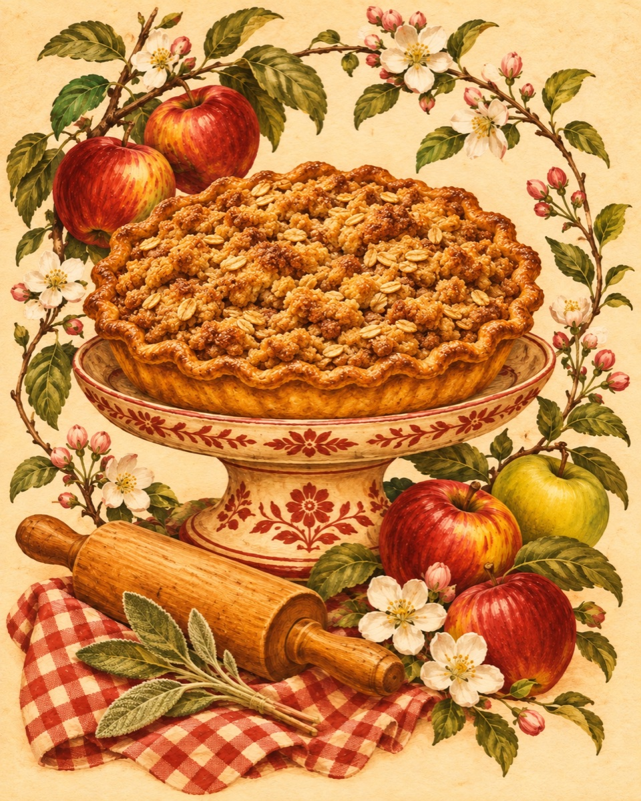

# The Conway Cookbook

A family recipe box for the dishes we make again, the notes we leave on the cards, and the meals we share.

**[Open the cookbook](https://cconway1-stevens.github.io/conway-cookbook/)** · [Browse recipes](https://cconway1-stevens.github.io/conway-cookbook/recipes/) · [Browse menus](https://cconway1-stevens.github.io/conway-cookbook/menus/) · [Add a recipe](#add-a-recipe)

<a href="https://cconway1-stevens.github.io/conway-cookbook/"></a>

## Cook from the site

- Search the recipe box by ingredient, cuisine, meal, or how much time you have.
- Open a complete meal from the menu library, or build your own. Print it, share it, or make a shopping list.
- Follow a recipe step by step in cook mode, with read-aloud directions and timers.
- Pick **Blue Plate** or **Heirloom** in Settings. Open the reading-help button for larger text, contrast controls, or less motion.

## Add a recipe

Contributors with write access to this repository can import an existing recipe or enter one by hand. Merging to `main` publishes the change through GitHub Pages.

### Import a recipe from a URL

1. Open the [Import recipe from URL workflow](https://github.com/cconway1-stevens/conway-cookbook/actions/workflows/import-recipe.yml).
2. Choose **Run workflow** on `main`. Paste a public HTTPS recipe URL, pick a course, and confirm you have permission to share the recipe publicly.
3. Open the finished run. Follow **Review draft and open a pull request** in its summary.
4. Check the ingredients, directions, and source credit. Make any edits on the draft branch, then open and merge the pull request when it’s ready.

The importer reads [Schema.org Recipe data](https://schema.org/Recipe) from the source page. It does not import photos. Draft branches are public on GitHub, but they do not appear in the cookbook unless you merge them. If a site blocks the request or does not supply recipe data, add the recipe by hand.

### Write a recipe by hand

1. Copy [the recipe template](recipe-template.json) into [`src/content/recipes/`](src/content/recipes/) as `sunday-pot-roast.json`. The filename becomes the recipe’s URL.
2. Fill in `title`, `description`, `category`, `time`, `servings`, `ingredients`, and `steps`. Delete optional fields you don’t use.
   - Use a course from [`src/data/cookbook.json`](src/data/cookbook.json), or a meal such as `Dinner`. Set `minutes` to include the recipe in the **Ready in** filter.
   - Write ingredients as lines or groups with `group` and `items`. Write steps as text or objects with `title`, `text`, and an optional `why` explanation, which opens from a “Why?” button.
   - Ingredient names in the steps show their amounts on hover. When an ingredient is in two groups and the page picks the wrong one, add `"group": "crumble"` (part of the group's name) to that step.
3. For a cover photo, add the file to [`public/images/`](public/images/) and set `image` (for example, `images/sunday-pot-roast.jpg`) and `imageAlt`.
4. Open a pull request. If a recipe fails validation, fix the file before merging.

You can also write a `.md` recipe with `## Ingredients` and numbered `## Directions`. [Sample recipes](src/content/recipes/samples/) fill out the demo collection. Moving one out of `samples/` keeps its URL.

## Publish a menu from the builder

Menus in the public library have their own pages. Each dish links back to its recipe.

1. Open the [menu builder](https://cconway1-stevens.github.io/conway-cookbook/menu/), choose **Add a dish**, and edit **Menu name** on the menu itself.
2. Under **Print & share**, choose **Copy share link**.
3. With repository write access, open the [Publish a menu draft workflow](https://github.com/cconway1-stevens/conway-cookbook/actions/workflows/publish-menu.yml). Choose **Run workflow** on `main`, paste the link, and add a library description.
4. Follow **Review draft and open a pull request** in the finished run. The menu joins the library after you merge the draft.

The builder keeps your working menu in the browser. Only submit plans and notes you want to share publicly. You can also add menu files by hand in [`src/content/menus/`](src/content/menus/), using recipe filenames as dish IDs.

## Photos, video, and notes

Recipe pages have a gallery and notes. Decide whether to keep your additions on this device or share them with everyone:

- **On this device**: Use the gallery and notes controls on a recipe page. Your additions stay in that browser.
- **For everyone**: Add gallery files to `src/media/<recipe-id>/`, or use the recipe’s GitHub link. Set `media` to customize captions, order, or embed links. Set `familyNotes` to publish notes. GitHub’s web upload accepts individual files up to 25 MB.

The build resizes gallery photos and strips hidden metadata from the copies it serves. Originals you commit stay public. The recipe page can save cleaned copies before you upload them.

## Develop and deploy

Use Node.js 24. Install dependencies and start Astro’s development server:

```bash
npm ci
npm run dev
```

Run `npm run build` to generate the site in `dist/`, or `npm run preview` to preview that build. The [Pages workflow](.github/workflows/pages.yml) deploys changes to `main`. To deploy your own copy, select **GitHub Actions** under **Settings → Pages**.

- [`src/data/cookbook.json`](src/data/cookbook.json): site text, courses, menu options, themes, and reading phrases
- [`src/themes/`](src/themes/): theme styles; [`src/motion.css`](src/motion.css): animations that respect reduced-motion settings
- [Cookbook JSON](https://cconway1-stevens.github.io/conway-cookbook/cookbook.json): the published recipe index

The deploy can record narration with Kokoro. If recording fails, cook mode uses a voice on the visitor’s device. Run `npm run narrate -- --list` to print the recording script. Local recording needs `ffmpeg` and downloads the voice model.

Reading help uses the [AccessibleWeb Widget](https://github.com/ifrederico/accessible-web-widget). Voice commands use on-device speech recognition when the browser supports it.

Made by Cameron Conway.

### Shopping quantities

A recipe can optionally list `shoppingMeasures` for quantities that are safe to add across dishes. Each record matches the original ingredient line exactly. For example, the tomato soup supplies `{ "line": "2 garlic cloves, minced", "ingredient": "garlic", "unit": "cloves", "quantity": 2 }`. Only identical ingredient and unit names combine. Other lines stay under their dish, with the author's wording intact.
